# AstraQuant

Local research project. One question: can a simple model forecast the Q1 2027 price
return of 11 stocks (6 US, 5 Indonesian banks) better than a naive baseline, and how wide
is the uncertainty?

The deliverable is a frozen, timestamped Q1 2027 forecast with 80% prediction intervals,
backed by a walk-forward evaluation on past quarters. "No model beats the baseline" is an
acceptable result.

Research and decision support only. Not investment advice, no trading.

## Limitations to keep in mind

- The 11 names were chosen with hindsight; results carry selection bias.
- A quarterly horizon gives about four independent observations per stock per year.
- Prices come from Yahoo Finance through yfinance: unofficial, for prototyping only.

## Setup

Requires Python 3.12, [uv](https://docs.astral.sh/uv/) and, on macOS, the OpenMP runtime
that LightGBM loads.

```bash
brew install libomp
uv venv --python 3.12 .venv
source .venv/bin/activate
uv pip install -e ".[dev,dashboard]"
```

## Use

```bash
python scripts/ingest.py          # download, clean, validate -> data/, reports/data_quality.md
python scripts/build_dataset.py   # targets and features -> data/processed/dataset/
python scripts/evaluate.py        # walk-forward evaluation -> reports/evaluation/summary.md
python scripts/forecast.py        # frozen forecast -> ledger, reports/q1_2027.md (after the last 2026 close)
python scripts/record_outcomes.py # realised returns -> ledger, reports/q1_2027_outcome.md (after 2027-03-31)
ruff check . && pytest            # checks
```

Optional read-only dashboard (forecasts with prediction intervals, evaluation results,
data freshness):

```bash
streamlit run dashboard/app.py
```

`data/` is not in Git. Every run records the git commit, data-through date and config digest.

## Dashboard screenshots

The dashboard runs locally and is not hosted. The screenshots below show every page and
every choice a viewer can make, captured on 2026-11-14 from the data of 2026-11-12. They are
static: they will not change when the forecast is frozen.

Three things to know before reading them:

- **No official forecast exists yet.** It is stored after the last 2026 close. The numbers on
  the forecast page come from a **rehearsal** on 2026Q3, run to test the pipeline. They are
  not a forecast and not a result of the project.
- The commit hashes shown inside the app (for example `da7d522`) refer to the history before
  this repository was created and are not commits of this repository.
- The volatility results look good, but only the quarterly return (`q_return`) decides the
  published model, and on it no model beat the baseline.

### Forecasts

What it answers: what is the forecast for each stock, and how wide is the uncertainty?

| Choice | Screenshot |
|---|---|
| Default view: no frozen forecast yet | 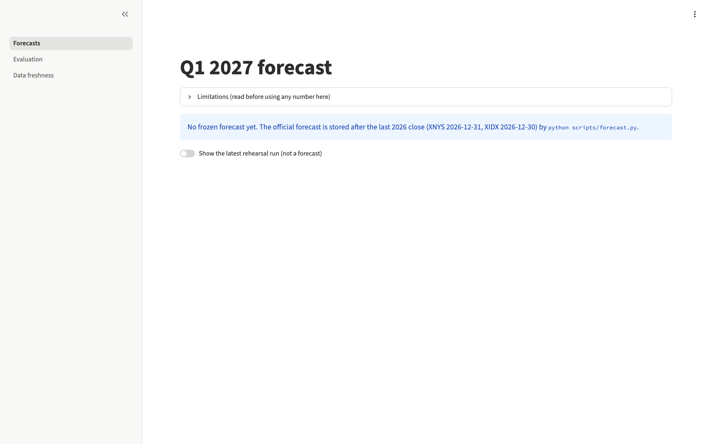 |
| "Limitations" opened (the same box is on every page) | 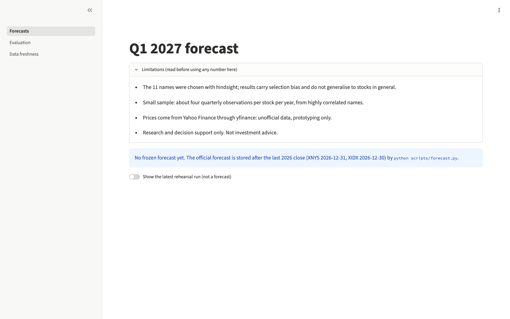 |
| "Show the latest rehearsal run" switched on | 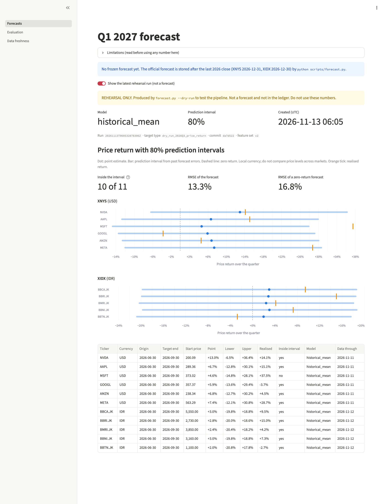 |

How to read the chart, one row per stock:

- **Blue dot:** point estimate.
- **Light bar:** 80% prediction interval, built from past forecast errors.
- **Dashed line:** zero return.
- **Orange tick:** the return that actually happened, once the quarter has ended.

Returns are in local currency, so price levels are not compared across markets.

After the official run, the page shows the frozen forecast in the same layout, plus an "All
runs in the ledger" list.

### Evaluation

What it answers: how did each model do when tested on past years it had not seen? The
"Target" menu has six choices.

**`q_return`, the primary target.** This one decides the published model.

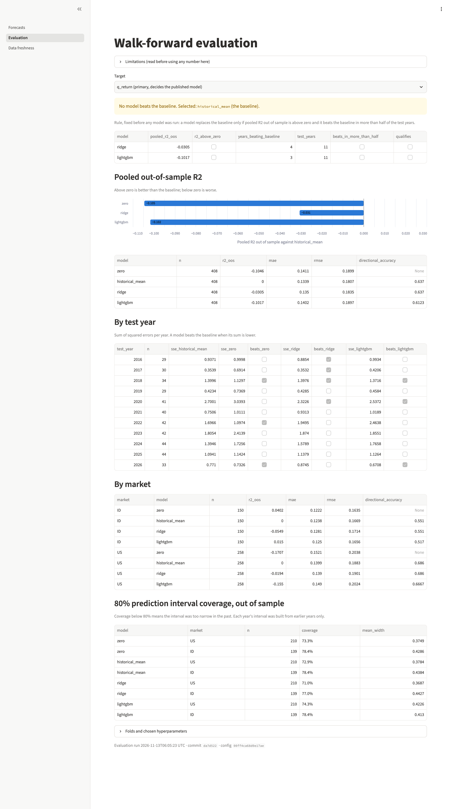

How to read it:

- **Coloured box:** the outcome of the selection rule.
- **R² bars:** above zero means better than the baseline, below zero means worse.
- **"By test year":** in which years each model beat the baseline.
- **Coverage:** how often the actual result fell inside the 80% interval.

The other five targets are secondary and shown for information only:

<details><summary><code>fwd_ret_5</code>: price return over 5 sessions</summary>

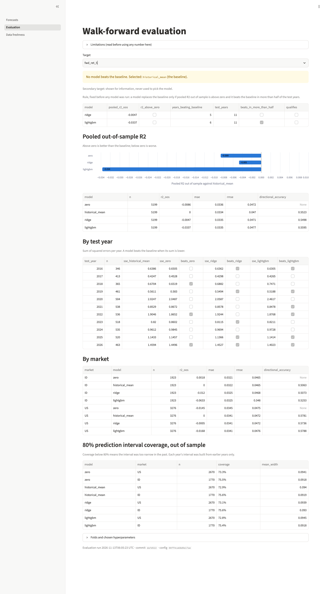
</details>

<details><summary><code>fwd_ret_20</code>: price return over 20 sessions</summary>

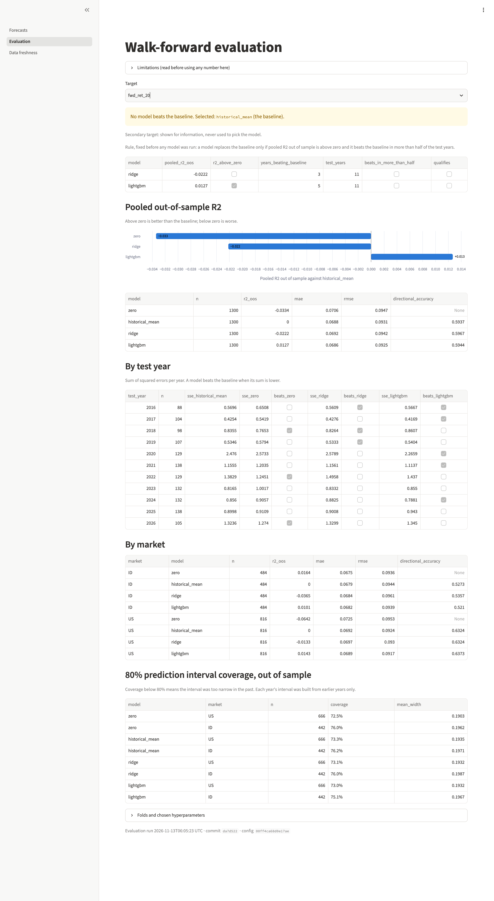
</details>

<details><summary><code>fwd_ret_60</code>: price return over 60 sessions</summary>

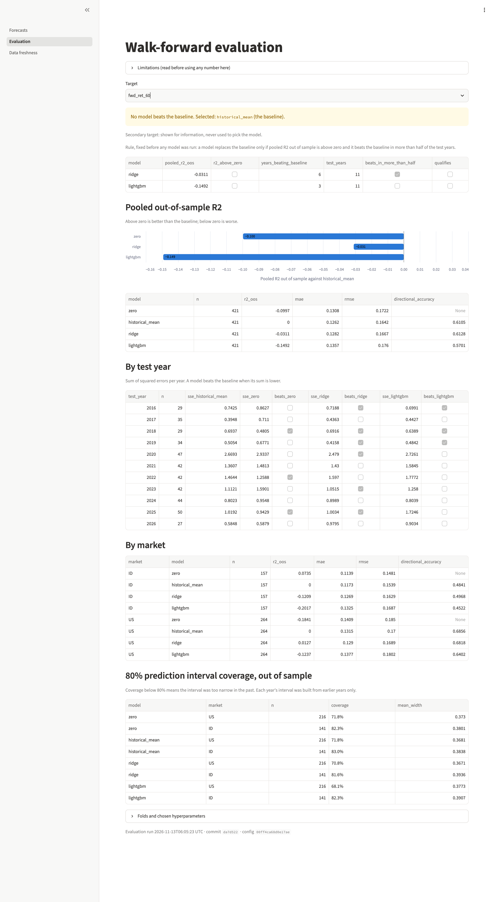
</details>

<details><summary><code>fwd_vol_20</code>: realised volatility over 20 sessions</summary>

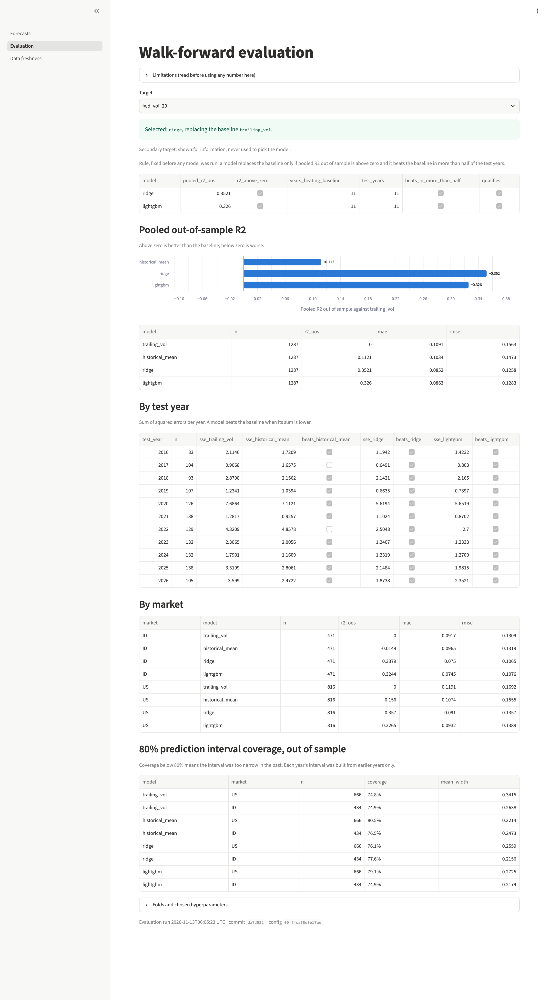
</details>

<details><summary><code>fwd_vol_60</code>: realised volatility over 60 sessions</summary>

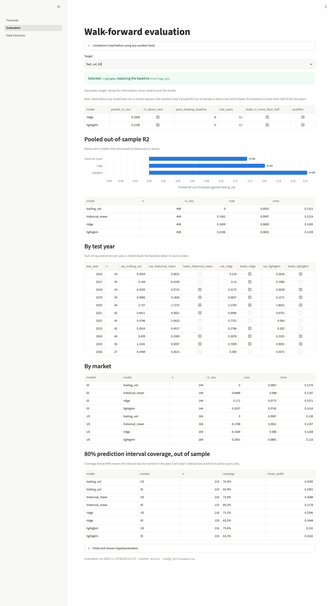
</details>

<details><summary>"Folds and chosen hyperparameters" opened (<code>q_return</code>)</summary>

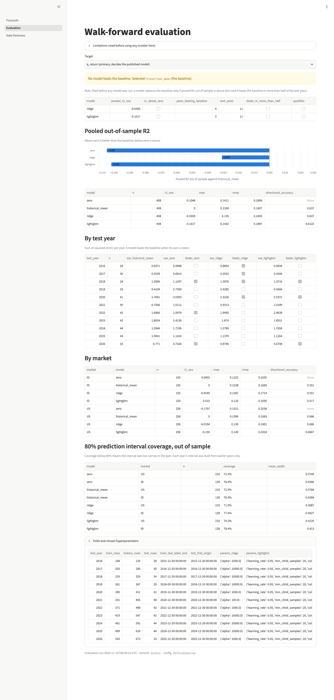
</details>

### Data freshness

What it answers: is the data recent enough, and when did each step last run?

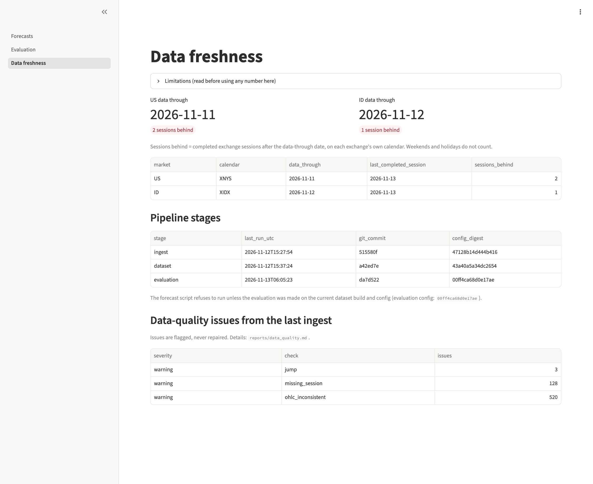

How to read it:

- **"N sessions behind":** completed trading sessions missing from the data. Weekends and
  holidays do not count.
- **"Pipeline stages":** when ingestion, dataset building and evaluation last ran.
- **Data-quality issues:** problems in the last download. They are flagged and never repaired.

## Where things are

| Path | Content |
|---|---|
| `docs/PROJECT_BLUEPRINT.md` | Specification (v2.0-lean). Read this first. |
| `docs/DECISIONS.md` | Decisions, assumptions and open questions, by milestone. |
| `docs/archive/` | Superseded v1.0 blueprint, kept for reference only. |
| `docs/screenshots/` | Dashboard screenshots used in this README. |
| `configs/` | Universe, horizons, feature windows, calendars. Nothing is hardcoded. |
| `src/astraquant/` | Package: calendars, data, targets, features, dataset, models, evaluation. |
| `scripts/` | Pipeline entry points. |
| `dashboard/` | Streamlit app. Reads outputs only; never writes. |
| `reports/` | Generated reports. |
| `tests/` | Unit and leakage tests; `tests/fixtures/` holds small real-data excerpts. |

## Status

Milestones 0 to 3 and the optional dashboard (5) are built. The tooling for Milestone 4
(ledger, forecast script, report) and Milestone 6 (outcome recording and report) is built
and rehearsed. Two steps remain and both wait for the calendar:

1. After the 2026-12-31 close: `ingest.py`, `build_dataset.py`, `evaluate.py`, `forecast.py`.
2. After the 2027-03-31 close: `ingest.py`, `build_dataset.py`, `record_outcomes.py`.

See blueprint section 9 and `docs/DECISIONS.md` sections 9 and 11.
